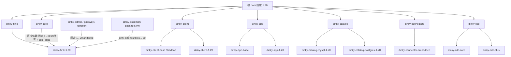

## 用户需求

将 Dinky 收敛为**只维护 Flink 1.20**，删除 1.14~1.19 全部旧版本相关内容。范围包含「全清理 +
文档」：模块、构建与打包配置、自动化脚本、部署与界面中的版本选项、以及使用文档里的版本矩阵与示例命令，全部统一为
1.20；版本选择机制「彻底扁平化」，不再保留多版本开关。

## 产品概述

改造后，产品从"同时支持七个 Flink 版本"变为"单一 1.20 版本"：源码树只保留一套版本化模块，构建产物只产出 1.20
的扩展包与发布包；安装脚本、容器与集群部署的默认值、界面上的版本下拉、以及文档中的支持版本说明均只出现
1.20。既有业务功能（元数据、调度、告警、作业执行、文档管理等）不受影响，且整仓仍可完整构建成功。

## 核心 Features

- 删除 1.14~1.19 的版本化模块及其残留构建产物，仅保留 1.20 一套模块。
- 版本选择开关全部移除，默认且唯一版本固定为 1.20，无需任何版本参数即可构建与部署。
- 发布包目录结构只保留 `flink1.20` 一套扩展目录；容器与集群部署默认值、界面版本下拉统一为 1.20。
- 文档中的支持版本矩阵、示例命令、目录树示例统一改为 1.20；历史发布文档与业务示例数据保持原样。
- 保留用户已有的未提交改动与 1.20 模块已修好的依赖配置，最终以全量构建通过作为验收。

## Tech Stack Selection

沿用现有已验证技术栈，不引入任何新框架或工具：Maven 多模块工程（Java 8 编译目标）、Spring Boot 2.7.18、Flink **1.20.2**
、MyBatis-Plus 3.5.7、Lombok 1.18.24。构建仍使用 JDK 8（`D:\APP\Scoop\apps\openjdk8-redhat\8u342-b07`）与项目级
`build/settings.xml`（绕开全局失效的 nexus 私服镜像），二者均已验证可用。前端仅改动一个版本下拉常量数组，不涉及框架与组件库变更。

## Implementation Approach

**策略**：三步走 —— (1) 用 `git rm -r` 物理删除 31 个旧版本模块目录（可逆、便于核对）；(2) 把「版本 profile 门控 + 动态
artifactId」整体改写为「固定 `&lt;modules&gt;` + 固定 1.20 artifactId 的直接依赖」，即彻底扁平化；(3) 全链路同步清理所有对旧版本字符串的引用。

**关键决策与权衡**：

- **彻底扁平化而非保留门控**：用户已明确选择。收益是默认构建即 1.20、无 `activeByDefault` 陷阱（现状 `flink-1.16`
  为默认激活，删模块后不带参数构建会直接失败）、无需维护多套依赖列表；代价是 CI/脚本中的 `-P flink-1.20`、
  `flink-single-version`、`flink-all` 参数变为无效 profile，必须同步删除，否则 Maven 报 warning。
- **依赖型 profile 不能简单删除**：`dinky-core`、`dinky-client-base`、`dinky-app-base`、`dinky-sandbox-*`、
  `dinky-connector-embedded` 的 profile 里承载着**实际依赖声明**（如 `dinky-flink-${dinky.flink.version}`、
  `dinky-cdc-plus`）。必须把其中 1.20 对应的依赖**上移到顶层 `&lt;dependencies&gt;`**，否则编译期缺类。已核实：
  `dinky-app-base`/`dinky-client-base` 的 `flink-all` 列表原本就漏了 1.20，`dinky-core` 原本没有 `flink-1.20` profile（
  `dinky-cdc-plus` 只在 1.15~1.19 profile 中引入），扁平化时须补齐这两处已有缺口。
- **根 pom 只保留 1.20 的 dependencyManagement 条目**：现状约 6 组 × 6 个旧版本条目，删后各 artifact 家族只留 `*-1.20` 一条；
  `dinky-connector-jdbc-1.14` 条目随模块删除一并移除。
- **`dinky-connectors/pom.xml` 的两个 profile 整体删除**：它们都指向唯一被删的 `dinky-connector-jdbc-1.14`，且没有 1.15+ 的
  jdbc 模块可替换；该父 pom 顶层只保留 `dinky-connector-embedded`。
- **不误改非 Flink 版本号**：`dinky-web/pom.xml` 的 `1.15.1` 是 node 前端依赖；helm `ingress.yaml` 的 1.14/1.18/1.19 是
  Kubernetes API 版本；`script/sql/**` 里 `dinky_flink_document.version='1.14'` 是业务示例数据，删除会破坏初始化数据；Java
  中 `FlinkUtils`/`FlinkConfig`/`FlinkAPI` 是运行时动态取版本逻辑 —— 全部保留。
- **运行时脚本按变量拼路径的逻辑保留**：`script/bin/auto.sh`、`init_flink_dependences.sh`、`init_cleanup.sh`
  、Dockerfile、docker-compose 用 `${FLINK_VERSION}` 动态拼接，属通用逻辑；只改硬编码默认值（`.env:21`、helm `values.yaml:71`
  的 `1.17` → `1.20`）并给 `init_tools_main.sh` 的 version_map 补上缺失的 1.20。

**性能与可靠性**：reactor 模块数从 53 降至约 22，编译时间与依赖解析量显著下降；IDE 索引范围与仓库体积同步减小。主要风险是
1.20 全量 reactor **尚未编译验证过**（此前只验证过 `dependency:resolve` 成功），扁平化后可能暴露 1.20
客户端/应用模块的编译错误，需按实际报错逐点修复，先 `test-compile` 收集全部错误再批量修，避免反复全量构建。

**避免技术债**：不新增任何 profile、脚本或兼容层；删除后立即用一次全量构建与一次残留引用扫描作为闭环验证。

## Implementation Notes

- **爆炸半径控制**：严禁覆盖用户现有未提交改动（`.idea/*.xml`、`MybatisPlusConfig.java`、`AdminTest.java`、
  `FlinkJobTaskTest.java`、`pom.xml`、`.vscode/`）。特别注意 `dinky-flink-1.20/pom.xml` 中已修好的 `1.20.2`、`2.3.0`、
  `3.3.0-1.20`、`3.4.0-1.20` 以及已删除的 4 个国产库定制依赖**必须原样保留**；`dinky-flink-1.16/pom.xml` 的改动会随目录删除自然消失。
- **用户自有配置不动**：`pom.xml` 中 `spotless.version=3.10.4`、`spotless.ratchetFrom=origin/dev` 属用户改动，不做修改。
- **本地构建必须跳过 spotless**：git 2.56 + JGit 的 ratchet 在本机必抛 NPE（与 JDK/spotless 版本无关），且 spotless 3.10.4 需
  Java 11+，本地 JDK 8 构建须带 `-Dspotless.skip=true`。`jdk11` profile 按 JDK 版本激活，与 Flink 无关，保留。
- **保留 `dinky-web/dist` 空目录占位**，否则 dinky-admin 的 copy-static 会中断 reactor。
- **删除用 `git rm -r`**，便于 `git status` 核对与回滚；`dinky-flink-1.18/target/` 为未跟踪构建产物，用文件系统删除即可。
- **IDEA 正在运行（PID 12568）**：`.idea` 文件被 gitignore，改动不入库，但需提示用户完全退出 IDEA 后重开再 Reload All Maven
  Projects，否则内存状态会覆盖磁盘配置。
- **验证命令**（扁平化后不再需要 flink profile）：
  `mvn -B -gs build/settings.xml clean install -P dev -DskipTests -Dspotless.skip=true`
  首次先跑 `test-compile` 收集编译错误，修完再跑完整 `install`。
- **日志**：用 `-B` 输出到日志文件，按模块定位 `[ERROR]`；避免把大段 pom/日志内容回显。

## Architecture Design

扁平化前后模块关系对比（只画受改动的部分）：



关键变化：所有 `flink-1.XX` / `flink-single-version` / `flink-all` profile 消失，子模块由父 pom 顶层 `&lt;modules&gt;`
直接声明；`dinky-core`、`dinky-client-base`、`dinky-app-base`、`dinky-sandbox-*`、`dinky-connector-embedded` 的版本依赖由
profile 内上移到顶层 `&lt;dependencies&gt;`，artifactId 全部写死为 `*-1.20`；`dinky-admin`/`dinky-gateway`/
`dinky-function` 的 `${dinky.flink.version}` 动态引用改为显式 `*-1.20`。

## Directory Structure

### [DELETE] 31 个旧版本模块目录（用 git rm -r）

```
dinky-flink/dinky-flink-1.14/ … dinky-flink-1.19/        # 6 个纯 pom 聚合模块；另删 dinky-flink-1.18/target 残留产物
dinky-client/dinky-client-1.14/ … dinky-client-1.19/      # 6 个，含各版本 executor/gateway 源码
dinky-app/dinky-app-1.14/ … dinky-app-1.19/              # 6 个，含 MainApp.java 与 resources
dinky-catalog/dinky-catalog-mysql/dinky-catalog-mysql-1.14/ … -1.19/       # 6 个，含 Catalog 实现
dinky-catalog/dinky-catalog-postgres/dinky-catalog-postgres-1.14/ … -1.19/  # 6 个，含 Catalog 实现
dinky-connectors/dinky-connector-jdbc-1.14/               # 1 个，无 1.15+ 替代模块，整体删除
```

保留：`dinky-flink-1.20`、`dinky-client-1.20`、`dinky-app-1.20`、`dinky-catalog-mysql-1.20`、`dinky-catalog-postgres-1.20`
及所有非版本化模块。

### [MODIFY] 根 pom 与父 pom（扁平化 + 固定 1.20）

```
pom.xml                                                     # 固定 dinky.flink.version=1.20 / flink.version=1.20.2；
                                                            # 删 dependencyManagement 中 1.14~1.19 的 client/catalog-mysql/
                                                            # catalog-postgres/flink 条目与 dinky-connector-jdbc-1.14；
                                                            # 删 flink-1.14~1.20、flink-single-version、flink-all 全部 profile；
                                                            # 保留 jdk11、maven-central、aliyun、apache-snapshots、web、dev、prod 等非版本配置
dinky-flink/pom.xml                                         # modules 直接写 dinky-flink-1.20，删除全部版本 profile
dinky-client/pom.xml                                        # modules = hadoop + base + dinky-client-1.20，删版本 profile
dinky-app/pom.xml                                           # modules = app-base + dinky-app-1.20，删版本 profile，保留 web profile
dinky-catalog/dinky-catalog-mysql/pom.xml                    # modules 直接写 mysql-1.20，删版本 profile
dinky-catalog/dinky-catalog-postgres/pom.xml                 # modules 直接写 postgres-1.20，删版本 profile
dinky-connectors/pom.xml                                    # 只保留 embedded；删 flink-1.14 与 flink-all 两个 profile
dinky-cdc/pom.xml                                           # modules = cdc-core + cdc-plus，删 flink-1.15~1.20 六个 profile
```

### [MODIFY] 依赖型 profile 上移为顶层固定依赖

```
dinky-core/pom.xml                       # 删 flink-1.14 / single / all / 1.15~1.19 全部 profile；
                                         # 顶层依赖固定为 catalog-mysql-1.20 / catalog-postgres-1.20 /
                                         # client-1.20 / flink-1.20，并补上原本只在 1.15~1.19 引入的 dinky-cdc-plus
dinky-client/dinky-client-base/pom.xml   # 顶层固定依赖 dinky-flink-1.20（原 single profile 内容），删两个版本 profile
dinky-app/dinky-app-base/pom.xml         # 顶层固定依赖 dinky-client-1.20 + dinky-flink-1.20，删两个版本 profile
dinky-sandbox/dinky-sandbox-base/pom.xml # single/all profile 收敛为顶层固定 1.20 依赖
dinky-sandbox/dinky-sandbox-memory/pom.xml                 # 同上
dinky-connectors/dinky-connector-embedded/pom.xml         # 同上，固定 catalog/client/flink 的 1.20 依赖
dinky-admin/pom.xml                      # dinky-client-${dinky.flink.version} / dinky-flink-${...} 改为显式 -1.20
dinky-gateway/pom.xml                    # 同上（45/50 行）
dinky-function/pom.xml                   # 同上（44/49 行）
dinky-assembly/pom.xml                   # finalName 中的 ${dinky.flink.version} 随根 pom 固定自动生效，仅核对
```

### [MODIFY] 构建 / CI / 打包 / 部署 / 运行时

```
dinky-assembly/src/main/assembly/package.xml   # 删 6 个 extends/flink1.14~1.19 fileSet，只保留 flink1.20；
                                               # 保留 client-base 与 dinky-app 正则 fileSet
build.cmd / build.sh                           # -P 参数去掉 flink-1.14 等版本 profile
build-extr.sh                                  # 去掉 -f 版本参数与 FLINK_VERSION 变量，CMD 只留 prod/aliyun/web 等；
                                               # 同步更新使用说明中的多版本示例
.github/workflows/backend.yaml                 # 矩阵缩为 ['1.20']，去掉 flink-${{ matrix.flink }} 与 -P flink-all
.github/workflows/docker_build.yaml            # 两处矩阵缩为 1.20，去掉版本 profile 参数
.github/workflows/auto-realease-ci.yml         # 删 6 个旧版本构建 step，只留 1.20
.github/workflows/format_code.yaml             # -P flink-all 去掉
script/bin/init_tools_main.sh                  # version_map 只留 1.20（并补上原本缺失的 1.20 映射）
deploy/docker/.env                             # FLINK_VERSION=1.17 → 1.20
deploy/kubernetes/helm/dinky/values.yaml       # flinkVersion: "1.17" → "1.20"
```

### [MODIFY] 前端与文档

```
dinky-web/src/pages/RegCenter/Document/constans.ts   # VERSIONS 数组只留 Flink-1.20（保留 All Versions 选项，属业务选项）
dinky-web/src/locales/zh-CN/pages.ts                  # 示例 jar 名 dinky-app-1.16/1.17 → 1.20
dinky-web/src/locales/en-US/pages.ts                  # 同上
docs/docs/deploy_guide/compile_deploy.md              # -P flink-1.16 等示例改为无版本参数
docs/docs/deploy_guide/normal_deploy.mdx              # extends/flink1.14~1.18 目录树、jar 名、支持版本矩阵、auto.sh start 1.16 统一为 1.20
docs/docs/deploy_guide/docker_deploy.md               # 版本字样统一 1.20
docs/docs/deploy_guide/kubernetes_deploy.md           # 版本字样统一 1.20
docs/docs/get_started/quick_experience.md             # 示例镜像/版本统一 1.20
docs/docs/practical_guide/Integration_practice/dinky_integration_flink.md  # 版本矩阵与命令统一 1.20
docs/docs/ 下其余含版本字样的约 17 个文件            # 逐个核对，仅当描述"当前支持版本/示例命令"时改为 1.20；
                                                      # 历史叙述、k8s API 版本、SQL 示例数据不改
```

不改：`docs/versioned_docs/**`、`docs/download/dinky-*.md`、`README.md`、`README_zh_CN.md`、`script/sql/**`。

### [MODIFY] IDE 配置（均被 gitignore，不入库）

```
.idea/misc.xml          # enabledProfiles 去掉所有 flink 版本 profile，只留 dev；disabledProfiles 相应精简
.idea/workspace.xml     # explicitlyEnabled/DisabledProfiles 同步；删 dinky-app-1.14/1.15 的 Maven 运行配置；
                        # 保留 userSettingsFile 指向 E:\code\GitHub\dinky\build\settings.xml
.idea/compiler.xml      # 删 1.14~1.19 的模块条目与 --add-exports 配置行
.idea/encodings.xml     # 删 1.14~1.19 的源码目录编码条目
```

## Key Code Structures

扁平化后各父 pom 需保持的统一形态（契约，非实现代码）：

| 位置                     | 形态                                                                                                                                                                                                     |
|--------------------------|----------------------------------------------------------------------------------------------------------------------------------------------------------------------------------------------------------|
| 父 pom `&lt;modules&gt;` | 直接列出 `dinky-*-1.20` 及非版本化模块，无任何 `&lt;profiles&gt;` 版本门控                                                                                                                               |
| 版本依赖                 | 顶层 `&lt;dependencies&gt;` 中 artifactId 写死为 `dinky-client-1.20` / `dinky-flink-1.20` / `dinky-catalog-mysql-1.20` / `dinky-catalog-postgres-1.20` / `dinky-cdc-plus`，scope 沿用 `${scope.runtime}` |
| 根 pom 属性              | `dinky.flink.version=1.20`、`flink.version=1.20.2`，仅用于 `finalName` 等展示用途，不参与模块选择                                                                                                        |
| 构建命令                 | 不再带任何 `flink-*` profile；`-P` 只保留 `dev`/`prod`/`web`/`aliyun` 等非版本 profile                                                                                                                   |

**验收标准**：`git status` 中删除项数量与预期一致；全仓 grep 不再出现指向已删模块的 artifactId 与版本 profile 名；JDK 8 下
`clean install`（跳过 spotless 与测试执行）全量 reactor BUILD SUCCESS，`test-compile` 亦通过；发布包 `extends/` 下只有
`flink1.20`。

## Agent Extensions

### SubAgent

- **code-explorer**
    - Purpose：在扁平化 20+ 个 pom 时跨文件核对所有 `flink-*` profile、`${dinky.flink.version}` 动态引用与硬编码旧版本
      artifactId 是否清理干净；并在 1.20 全量构建暴露编译错误时定位报错符号的定义与调用链。
    - Expected outcome：输出一份"仍引用旧版本的文件清单"（应为空或仅剩明确豁免项），以及每处编译错误对应的文件与修复建议，确保无遗漏、无盲目改动。
